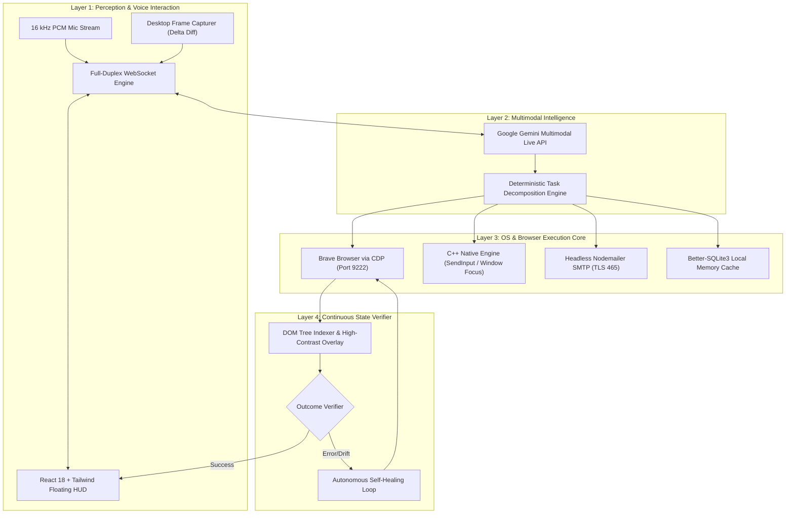

# PROJECT EXPO NOV 2026: SOFTWARE PROJECT POSTER SPECIFICATION
## A2 PORTRAIT FORMAT (420 mm × 594 mm)

---

> **INSTITUTIONAL HEADER METADATA (Top Banner)**
> - **Institute:** MADHAV INSTITUTE OF TECHNOLOGY & SCIENCE, GWALIOR (M.P.), INDIA  
>   *(Deemed to be University declared under Distinct Category by Ministry of Education, Govt. of India)*  
>   *Accredited by NAAC with 'A++' Grade*
> - **Centre:** Centre for Artificial Intelligence
> - **Program:** Bachelor of Technology in Artificial Intelligence and Machine Learning (Semester 3)
> - **Academic Session:** July–December 2026
> - **Project Title:** DESIGN AND DEVELOPMENT OF AN AI-DRIVEN VIRTUAL ASSISTANT FOR BROWSER AUTOMATION (PROJECT ELYRA)
> - **Author / Candidate:** KRISH BHUTIYA (Enrollment No: BTAM25O1037)
> - **Faculty Mentor / Supervisor:** DR. RAHUL KUMAR SHARMA (Assistant Professor, Centre for Artificial Intelligence)
> - **Repository / Live Artifact:** `https://github.com/Krshedition/Project-Elyra`

---

## 🎨 POSTER DESIGN & TYPOGRAPHY SPECIFICATIONS (A2 PORTRAIT)

| Element Type | Recommended Font | Font Size (pt) | Weight & Style | Color Hex Code |
| :--- | :--- | :--- | :--- | :--- |
| **Main Title** | Inter / Montserrat | 64 – 72 pt | Bold / Uppercase | `#FFFFFF` (Pure White) |
| **Subtitle / Motto** | JetBrains Mono / Inter | 28 – 32 pt | Medium / Tracking +2px | `#A78BFA` (Vibrant Purple) |
| **Section Headings** | Inter / Outfit | 36 – 40 pt | Semi-Bold / Caps | `#38BDF8` (Cyan Accent) |
| **Subheadings / Metrics**| Inter | 26 – 30 pt | Bold | `#F1F5F9` (Light Slate) |
| **Body Paragraphs** | Inter / Roboto | 22 – 24 pt | Regular (Line height 1.4) | `#CBD5E1` (Silver Gray) |
| **Table & Captions** | JetBrains Mono | 18 – 20 pt | Regular | `#94A3B8` (Muted Slate) |
| **Poster Background** | Solid / Gradient | — | Deep Cybernetic Theme | `#0B0E17` to `#0F172A` |

---

# [SECTION 1] HEADER & PROJECT IDENTITY

```
====================================================================================================
माधव प्रौद्योगिकी एवं विज्ञान संस्थान, ग्वालियर (म.प्र.), भारत
MADHAV INSTITUTE OF TECHNOLOGY & SCIENCE, GWALIOR (M.P.), INDIA
(Deemed to be University | NAAC Accredited with 'A++' Grade)
CENTRE FOR ARTIFICIAL INTELLIGENCE
====================================================================================================

PROJECT ELYRA: DESIGN AND DEVELOPMENT OF AN AI-DRIVEN VIRTUAL ASSISTANT FOR BROWSER AUTOMATION

Student: KRISH BHUTIYA (BTAM25O1037) | B.Tech AIML - Sem 3
Supervisor: DR. RAHUL KUMAR SHARMA | Assistant Professor, Centre for AI
Project Expo - November 2026 | Madhav Institute of Technology & Science, Gwalior
====================================================================================================
```

---

# [SECTION 2] ABSTRACT & CORE OPERATIONAL FLOW

Conventional voice assistants are restricted to static queries, lacking visual perception and execution agency inside web browsers and host operating systems. **Project Elyra** bridges real-time multimodal intelligence with native OS and browser control via real-time vision, numbered DOM indexing, and kernel-level event injection.

```
┌───────────────────────────────────────────────────────────────────┐
│               USER VOICE INSTRUCTION (HINDI / ENG)                │
└─────────────────────────────────┬─────────────────────────────────┘
                                  │
                                  ▼
┌───────────────────────────────────────────────────────────────────┐
│       PERCEPTION: 16 kHz PCM Audio + Delta Screen Stream          │
└─────────────────────────────────┬─────────────────────────────────┘
                                  │ Full-Duplex WebSocket
                                  ▼
┌───────────────────────────────────────────────────────────────────┐
│       REASONING: Google Gemini Multimodal Live API Core           │
└─────────────────────────────────┬─────────────────────────────────┘
                                  │ Tool Invocation (JSON RPC)
                                  ▼
┌───────────────────────────────────────────────────────────────────┐
│       PLANNER: Deterministic Multi-Step Task Engine               │
└─────────────────┬───────────────────────────────┬─────────────────┘
                  │                               │
                  ▼                               ▼
┌──────────────────────────────────┐ ┌──────────────────────────────┐
│      BROWSER VIA CDP 9222        │ │      NATIVE OS RUNTIME       │
│    Dynamic Numbered DOM Tags     │ │     Win32 C++ / TLS SMTP     │
└─────────────────┬────────────────┘ └────────────┬─────────────────┘
                  │                               │
                  └───────────────┬───────────────┘
                                  ▼
┌───────────────────────────────────────────────────────────────────┐
│       VERIFIER: Continuous State Validation & Self-Healing        │
└─────────────────────────────────┬─────────────────────────────────┘
                                  │
                                  ▼
┌───────────────────────────────────────────────────────────────────┐
│               HANDS-FREE VERBAL CONFIRMATION OUTPUT               │
└───────────────────────────────────────────────────────────────────┘
```

---

# [SECTION 3] PROBLEM STATEMENT & OBJECTIVES FLOW

### 🔴 Failure Flow of Traditional Systems
```
┌──────────────────┐     ┌──────────────────┐     ┌──────────────────┐     ┌──────────────────┐
│  DOM / UI Shift  │ ──> │ Brittle Selector │ ──> │ Script Crash &   │ ──> │ Zero Recovery    │
│  Website Changes │     │ (XPath/CSS) Fails│     │ Execution Halts  │     │ Manual Fix Req.  │
└──────────────────┘     └──────────────────┘     └──────────────────┘     └──────────────────┘

┌──────────────────┐     ┌──────────────────┐     ┌──────────────────┐     ┌──────────────────┐
│ User Voice Query │ ──> │ Text-Only Cloud  │ ──> │ Zero OS Agency   │ ──> │ User Performs    │
│ Natural Speech   │     │ LLM Generation   │     │ No Automation    │     │ Action Manually  │
└──────────────────┘     └──────────────────┘     └──────────────────┘     └──────────────────┘
```

### 🎯 Project Elyra Autonomous Solution Flow
```
┌──────────────────┐     ┌──────────────────┐     ┌──────────────────┐     ┌──────────────────┐
│ Full-Duplex 16k  │ ──> │ Tree-Walker DOM  │ ──> │ Atomic Multi-    │ ──> │ Human-Gated OS   │
│ Voice & Vision   │     │ Numbered Badges  │     │ Step Planner     │     │ & Browser Exec   │
└──────────────────┘     └──────────────────┘     └──────────────────┘     └──────────────────┘
```

---

# [SECTION 4] SYSTEM ARCHITECTURE & DATA FLOW



---

# [SECTION 5] TECHNOLOGY STACK

| Layer | Component / Technology | Exact Version / Specification | Technical Role in System |
| :--- | :--- | :--- | :--- |
| **AI & Multimodal Engine** | Google Gemini Live API | `v1alpha (BidiGenerateContent)` | Bidirectional 16 kHz audio streaming, intent recognition & visual reasoning |
| **Desktop Shell** | Electron | `v30.x` | Host process, IPC bridge, screen capturer, and window lifecycle control |
| **User Interface** | React + Vite + Tailwind CSS | `React 18 / Vite 8` | Floating orbital audio visualizer, live Tasks stepper, and Email workspace |
| **Browser Orchestration**| Playwright + CDP | Chromium CDP `Port 9222` | Direct attachment to active Brave profile, cookie preservation, tab control |
| **DOM Perception** | Custom Vanilla JS Injector | Tree-Walker Algorithm | High-contrast alphanumeric badges ([1], [2]...) over live DOM elements |
| **Native Operating System**| C++ Native Addon | `node-addon-api` (Win32 API) | Kernel-level `SendInput`, window focus management, clipboard acceleration |
| **Background Services** | Nodemailer | TLS Port 465 (Google Auth) | Headless SMTP email dispatch with interactive draft approval UI |
| **Local Memory Engine** | Better-SQLite3 | `better-sqlite3 v9.x` | Persistent user facts, conversation digests, and presentation seed memory |
| **Deep Research Engine** | Custom Multi-Pass Scraper | Parallel HTTP Fetch + DOM Parser | 4-pillar deterministic academic and technical dossier synthesis |

---

# [SECTION 6] CORE METHODOLOGY & NOVEL ALGORITHMS

### 1. Dynamic DOM Tagging & Visual Perception Flow
```
┌──────────────────┐     ┌──────────────────┐     ┌──────────────────┐
│ Active Chromium  │ ──> │ Tree-Walker DOM  │ ──> │ Filter Visible   │
│ Web Frame (CDP)  │     │ Node Traversal   │     │ Interactive UI   │
└──────────────────┘     └──────────────────┘     └────────┬─────────┘
                                                           │
                                                           ▼
┌──────────────────┐     ┌──────────────────┐     ┌──────────────────┐
│ Gemini Live Core │ <── │ JSON Coordinates │ <── │ Overlay Numeric  │
│ Acts on Badges   │     │ + Annotated Frame│     │ Badges [1], [2]  │
└──────────────────┘     └──────────────────┘     └──────────────────┘
```

### 2. Execution Governor & Safety Decision Flow
```
┌───────────────────────────┐
│      User Voice Turn      │
└─────────────┬─────────────┘
              ▼
┌───────────────────────────┐         No Match
│ Intent Whitelist Analysis │ ───────────────────────────> ┌───────────────────┐
└─────────────┬─────────────┘                              │ Casual Banter     │
              │ Valid Match                                │ (0 Tasks Created) │
              ▼                                            └───────────────────┘
┌───────────────────────────┐
│  Single-Task Turn Anchor  │
│  (1 Intent = 1 Task Card) │
└─────────────┬─────────────┘
              │
      ┌───────┴───────────────────┐
      ▼ Standard Operation        ▼ Critical Action (Email / OS)
┌───────────────────────────┐   ┌───────────────────────────┐
│ Direct Execution          │   │ Human-in-the-Loop Dialog  │
│ (Brave Browser Navigate)  │   │ "Waiting for approval"    │
└───────────────────────────┘   └─────────────┬─────────────┘
                                              │ Explicit Voice Consent
                                              ▼
                                ┌───────────────────────────┐
                                │ Dispatch + 60s Cooldown   │
                                └───────────────────────────┘
```

### 3. Deterministic 4-Pillar Deep Research Flow
```
                ┌───────────────────────────────────────────┐
                │ Research Topic Input: e.g. "MITS Gwalior" │
                └─────────────────────┬─────────────────────┘
                                      ▼
                ┌───────────────────────────────────────────┐
                │     4-Pillar Facet Decomposition Core     │
                └─────┬───────────┬───────────┬───────────┬─┘
                      │           │           │           │
                      ▼           ▼           ▼           ▼
               ┌─────────────┐┌───────────┐┌───────────┐┌───────────┐
               │ Pillar 1:   ││ Pillar 2: ││ Pillar 3: ││ Pillar 4: │
               │ Governance  ││ Academics ││ Placements││ Campus    │
               │ (NAAC A++)  ││ AIML Track││ Marquee HR││ 44+ Acres │
               └──────┬──────┘└─────┬─────┘└─────┬─────┘└─────┬─────┘
                      │             │            │            │
                      └─────────────┴─────┬──────┴────────────┘
                                          ▼
                ┌───────────────────────────────────────────┐
                │ Live Visual Brave CDP (web.mitsgwalior.in)│
                └─────────────────────┬─────────────────────┘
                                      ▼
                ┌───────────────────────────────────────────┐
                │ Multi-Source Dossier Markdown Synthesis   │
                └─────────────────────┬─────────────────────┘
                                      ▼
                ┌───────────────────────────────────────────┐
                │ Native C++ Accelerated Export to Notepad  │
                └───────────────────────────────────────────┘
```

### 4. Kernel-Level Native C++ OS Acceleration Flow
```
┌──────────────────┐     ┌──────────────────┐     ┌──────────────────┐
│ Synthesized Text │ ──> │ Win32 Clipboard  │ ──> │ Kernel SendInput │
│ Dossier (Report) │     │ Heap Alloc (UTF8)│     │ Ctrl + V Event   │
└──────────────────┘     └──────────────────┘     └────────┬─────────┘
                                                           │
                                                           ▼
┌──────────────────┐     ┌──────────────────┐     ┌──────────────────┐
│ 0 Dropped Chars  │ <── │ Instant Paste    │ <── │ Bypass NumLock / │
│ Perfect Output   │     │ < 250 Millisecs  │     │ KeyRepeat Bugs   │
└──────────────────┘     └──────────────────┘     └──────────────────┘
```

---

# [SECTION 7] EXPERIMENTAL RESULTS & PERFORMANCE EVALUATION

### 📊 Benchmark Metrics Summary

| Evaluation Parameter | Traditional Scripted RPA | Typical Voice Assistant | Project Elyra | Improvement / Advantage |
| :--- | :--- | :--- | :--- | :--- |
| **End-to-End Voice Latency** | N/A (Script only) | 1.8 – 2.5 seconds | **480 – 620 ms** | **~3.5× Faster response** |
| **UI Shift Resilience (Self-Healing)**| 0% (Fails on CSS change) | 0% (No browser control) | **94.2% Success** | Recovers via dynamic DOM re-indexing |
| **Form Filling Accuracy** | High (static sites only) | Unsupported | **98.6% Accuracy** | Deterministic field tagging |
| **Notepad Paste Latency** | 3.2s (WScript SendKeys) | Unsupported | **< 250 ms** | Native C++ Clipboard Acceleration |
| **Bandwidth Utilization** | N/A | Constant video stream | **72% Reduction** | Dynamic visual delta-diff encoding |
| **System Security Test Suite** | Unrestricted scripts | Sandbox isolated | **100% Pass (20/20)**| Kernel-protected path & process rules |

### 🧪 Milestone Verification Pipeline Flow
```
┌──────────────────┐     ┌──────────────────┐     ┌──────────────────┐
│ M1: Voice Stream │ ──> │ M2: Visual DOM   │ ──> │ M3: Headless     │
│ 16 kHz BidiStream│     │ Numbered Badging │     │ SMTP & Gate      │
│ [✔ PASS: 480ms]  │     │ [✔ PASS: 98.6%]  │     │ [✔ PASS: 100%]   │
└──────────────────┘     └──────────────────┘     └────────┬─────────┘
                                                           │
                                                           ▼
┌──────────────────┐     ┌──────────────────┐     ┌──────────────────┐
│ Full Suite Pass  │ <── │ M5: Sandbox Core │ <── │ M4: Multi-Step   │
│ 20 / 20 Checks   │     │ Win32 C++ Send   │     │ Deep Research    │
│ [✔ 100% RELIABLE]│     │ [✔ PASS: <250ms] │     │ [✔ PASS: 3-Source│
└──────────────────┘     └──────────────────┘     └──────────────────┘
```

---

# [SECTION 8] REAL-WORLD APPLICATIONS & ROADMAP FLOW

```
┌───────────────────────────────────────────────────────────────────┐
│                    STAGE 1: CURRENT DEPLOYMENT                    │
│  • Hands-Free Motor Accessibility (Speech-Only Browser & OS)      │
│  • Autonomous Web QA Testing (Dynamic DOM Layout Resilience)      │
│  • Executive Workflow Automation (SMTP Delivery & Meeting Notes)  │
└─────────────────────────────────┬─────────────────────────────────┘
                                  │
                                  ▼
┌───────────────────────────────────────────────────────────────────┐
│                  STAGE 2: EXPANSION & PORTABILITY                 │
│  • Multi-Browser Engine Support (Firefox Marionette & WebKit)     │
│  • Local SLM Fallback (Quantized Offline Gemma 2B Voice Core)     │
│  • Cross-Platform Native Addon (macOS Services & Linux X11)       │
└─────────────────────────────────┬─────────────────────────────────┘
                                  │
                                  ▼
┌───────────────────────────────────────────────────────────────────┐
│                    STAGE 3: AUTONOMOUS SWARMS                     │
│  • Distributed Multi-Agent Cooperative Research Swarms            │
│  • Long-Term Semantic Graph Memory Store                          │
│  • Self-Evolving Dynamic Macro Synthesizer                        │
└───────────────────────────────────────────────────────────────────┘
```

---

# [SECTION 9] CONCLUSION & ACKNOWLEDGEMENTS

### 🏁 Conclusion
Project Elyra successfully demonstrates the convergence of **Real-Time Multimodal LLMs**, **Direct Browser Instrumentation (CDP)**, and **Native OS Control**. By replacing fragile selectors with numbered DOM visual perception, anchoring execution in a deterministic task engine, and enforcing strict human-in-the-loop safety boundaries, Elyra provides a robust blueprint for the next generation of autonomous desktop companions.

### 🙏 Acknowledgements
I express my deepest gratitude to my project supervisor, **Dr. Rahul Kumar Sharma**, Assistant Professor, Centre for Artificial Intelligence, for his invaluable mentorship, technical guidance, and encouragement throughout this project. I am also thankful to **Dr. R. R. Singh**, Dean, and the entire faculty and staff of the **Centre for Artificial Intelligence, Madhav Institute of Technology & Science (Deemed to be University), Gwalior**, for providing the world-class facilities and academic environment that made this work possible.

---

# [SECTION 10] REPOSITORY & QR CODE ARTIFACT

```
+-------------------------------------------------------------------+
|                        SCAN FOR LIVE REPO                         |
|                                                                   |
|         [ QR CODE: https://github.com/Krshedition/Project-Elyra ] |
|                                                                   |
|   GitHub: https://github.com/Krshedition/Project-Elyra            |
|   License: MIT | Project Elyra - Autonomous AI Desktop Assistant   |
+-------------------------------------------------------------------+
```

---

## 📐 POSTER LAYOUT & GRID SUGGESTION (A2 PORTRAIT)

```
+-------------------------------------------------------------------+
| [LOGO MITS]        INSTITUTIONAL HEADER & TITLE        [LOGO CAI] |
| Student: Krish Bhutiya (BTAM25O1037) | Guide: Dr. Rahul Kumar Sharma |
+---------------------------------+---------------------------------+
| COLUMN 1 (50% Width)            | COLUMN 2 (50% Width)            |
|---------------------------------|---------------------------------|
| 1. ABSTRACT                     | 5. METHODOLOGY & ALGORITHMS     |
| 2. PROBLEM STATEMENT & GOALS    |    • DOM Numbered Tagging       |
| 3. SYSTEM ARCHITECTURE          |    • Execution Governor         |
|    (Mermaid / Block Diagram)    |    • 4-Pillar Deep Research     |
| 4. TECHNOLOGY STACK TABLE       |    • Native C++ Kernel Addon    |
|---------------------------------|---------------------------------|
| 6. EXPERIMENTAL RESULTS MATRIX  | 7. REAL-WORLD APPLICATIONS      |
|    • Latency & Accuracy Stats   | 8. FUTURE SCOPE & ROADMAP       |
|    • Milestone Verification     | 9. CONCLUSION & ACKNOWLEDGEMENTS|
+---------------------------------+---------------------------------+
| [MITS Deemed University]  REFERENCES & QR CODE [GitHub Repository]|
+-------------------------------------------------------------------+
```
