# PROJECT EXPO NOV 2026: SOFTWARE PROJECT POSTER SPECIFICATION
## A2 PORTRAIT FORMAT (420 mm × 594 mm)

---

> **INSTITUTIONAL HEADER METADATA (Top Banner)**
> - **Institute:** MADHAV INSTITUTE OF TECHNOLOGY & SCIENCE, GWALIOR (M.P.), INDIA  
>   *(Deemed to be University declared under Distinct Category by Ministry of Education, Govt. of India)*  
>   *Accredited by NAAC with 'A++' Grade*
> - **Centre:** Centre for Artificial Intelligence
> - **Program:** Bachelor of Technology in Artificial Intelligence and Machine Learning (Semester 3)
> - **Academic Session:** July–December 2026
> - **Project Title:** DESIGN AND DEVELOPMENT OF AN AI-DRIVEN VIRTUAL ASSISTANT FOR BROWSER AUTOMATION (PROJECT ELYRA)
> - **Author / Candidate:** KRISH BHUTIYA (Enrollment No: BTAM25O1037)
> - **Faculty Mentor / Supervisor:** DR. RAHUL KUMAR SHARMA (Assistant Professor, Centre for Artificial Intelligence)
> - **Repository / Live Artifact:** `https://github.com/Krshedition/Project-Elyra`

---

## 🎨 POSTER DESIGN & TYPOGRAPHY SPECIFICATIONS (A2 PORTRAIT)

| Element Type | Recommended Font | Font Size (pt) | Weight & Style | Color Hex Code |
| :--- | :--- | :--- | :--- | :--- |
| **Main Title** | Inter / Montserrat | 64 – 72 pt | Bold / Uppercase | `#FFFFFF` (Pure White) |
| **Subtitle / Motto** | JetBrains Mono / Inter | 28 – 32 pt | Medium / Tracking +2px | `#A78BFA` (Vibrant Purple) |
| **Section Headings** | Inter / Outfit | 36 – 40 pt | Semi-Bold / Caps | `#38BDF8` (Cyan Accent) |
| **Subheadings / Metrics**| Inter | 26 – 30 pt | Bold | `#F1F5F9` (Light Slate) |
| **Body Paragraphs** | Inter / Roboto | 22 – 24 pt | Regular (Line height 1.4) | `#CBD5E1` (Silver Gray) |
| **Table & Captions** | JetBrains Mono | 18 – 20 pt | Regular | `#94A3B8` (Muted Slate) |
| **Poster Background** | Solid / Gradient | — | Deep Cybernetic Theme | `#0B0E17` to `#0F172A` |

---

# [SECTION 1] HEADER & PROJECT IDENTITY

```
====================================================================================================
माधव प्रौद्योगिकी एवं विज्ञान संस्थान, ग्वालियर (म.प्र.), भारत
MADHAV INSTITUTE OF TECHNOLOGY & SCIENCE, GWALIOR (M.P.), INDIA
(Deemed to be University | NAAC Accredited with 'A++' Grade)
CENTRE FOR ARTIFICIAL INTELLIGENCE
====================================================================================================

PROJECT ELYRA: DESIGN AND DEVELOPMENT OF AN AI-DRIVEN VIRTUAL ASSISTANT FOR BROWSER AUTOMATION

Student: KRISH BHUTIYA (BTAM25O1037) | B.Tech AIML - Sem 3
Supervisor: DR. RAHUL KUMAR SHARMA | Assistant Professor, Centre for AI
Project Expo - November 2026 | Madhav Institute of Technology & Science, Gwalior
====================================================================================================
```

---

# [SECTION 2] ABSTRACT

Traditional voice assistants (Siri, Alexa, Google Assistant) operate within rigid, pre-programmed boundaries, answering simple queries or opening desktop apps, but remaining fundamentally blind and helpless inside dynamic web interfaces and host operating systems. 

**Project Elyra** breaks this paradigm by introducing an autonomous, multimodal desktop AI assistant that operates web applications and Windows OS workflows exactly like an expert human user. By combining the bidirectional **Google Gemini Multimodal Live API** (WebSocket 16 kHz audio & vision), **Chrome DevTools Protocol (CDP port 9222)** via Playwright, and a custom **C++ Native Addon (`node-addon-api`)**, Elyra perceives the desktop screen, indexes dynamic interactive elements with high-contrast numbered badges, and executes complex end-to-end tasks (form automation, video navigation, multi-source deep research, and secure headless SMTP email delivery) entirely via hands-free voice commands.

---

# [SECTION 3] PROBLEM STATEMENT & OBJECTIVES

### 🔴 Problem Statement
- **Brittle Web Automation:** Conventional frameworks (Selenium, Puppeteer) depend on hardcoded XPath/CSS selectors that break instantly whenever website layouts shift.
- **Disconnected AI Assistants:** Contemporary conversational AI models generate instructions in text but possess zero agency to execute them directly on user machines.
- **Lack of Autonomous Recovery:** Existing systems lack contextual self-healing, causing scripts to fail completely when confronted with popups, dynamic modals, or DOM mutations.

### 🎯 Key Objectives
1. **Real-Time Multimodal Voice & Vision:** Establish a sub-second, full-duplex WebSocket stream carrying 16 kHz PCM voice and delta-compressed screen frames.
2. **Visual DOM-Tagging Engine:** Eliminate brittle selectors by overlaying deterministic numbered badges ([1], [2], [3]...) over visible interactive elements.
3. **Deterministic Multi-Step Task Planner:** Decompose open-ended natural language instructions into atomic, verifiable sub-problems with autonomous rollback and healing.
4. **Human-in-the-Loop Headless Security:** Execute background email dispatch and kernel-level OS commands with strict rate-limiting, cooldowns, and mandatory physical confirmations.

---

# [SECTION 4] SYSTEM ARCHITECTURE & DATA FLOW

```mermaid
flowchart TD
    subgraph Client_Perception ["Layer 1: Perception & Voice Interaction"]
        MIC["16 kHz PCM Mic Stream"] --> WS_CONN["Full-Duplex WebSocket Engine"]
        SCREEN["Desktop Frame Capturer (Delta Diff)"] --> WS_CONN
        UI["React 18 + Tailwind Floating HUD"] <--> WS_CONN
    end

    subgraph AI_Reasoning_Cloud ["Layer 2: Multimodal Intelligence"]
        WS_CONN <--> GEMINI["Google Gemini Multimodal Live API"]
        GEMINI --> PLANNER["Deterministic Task Decomposition Engine"]
    end

    subgraph Execution_Core ["Layer 3: OS & Browser Execution Core"]
        PLANNER --> BRAVE["Brave Browser via CDP (Port 9222)"]
        PLANNER --> NATIVE["C++ Native Engine (SendInput / Window Focus)"]
        PLANNER --> SMTP["Headless Nodemailer SMTP (TLS 465)"]
        PLANNER --> MEMORY["Better-SQLite3 Local Memory Cache"]
    end

    subgraph Verification_Layer ["Layer 4: Continuous State Verifier"]
        BRAVE --> TAGGER["DOM Tree Indexer & High-Contrast Overlay"]
        TAGGER --> VERIFY{"Outcome Verifier"}
        VERIFY -- Success --> UI
        VERIFY -- Error/Drift --> HEAL["Autonomous Self-Healing Loop"]
        HEAL --> BRAVE
    end
```



---

# [SECTION 5] TECHNOLOGY STACK

| Layer | Component / Technology | Exact Version / Specification | Technical Role in System |
| :--- | :--- | :--- | :--- |
| **AI & Multimodal Engine** | Google Gemini Live API | `v1alpha (BidiGenerateContent)` | Bidirectional 16 kHz audio streaming, intent recognition & visual reasoning |
| **Desktop Shell** | Electron | `v30.x` | Host process, IPC bridge, screen capturer, and window lifecycle control |
| **User Interface** | React + Vite + Tailwind CSS | `React 18 / Vite 8` | Floating orbital audio visualizer, live Tasks stepper, and Email workspace |
| **Browser Orchestration**| Playwright + CDP | Chromium CDP `Port 9222` | Direct attachment to active Brave profile, cookie preservation, tab control |
| **DOM Perception** | Custom Vanilla JS Injector | Tree-Walker Algorithm | High-contrast alphanumeric badges ([1], [2]...) over live DOM elements |
| **Native Operating System**| C++ Native Addon | `node-addon-api` (Win32 API) | Kernel-level `SendInput`, window focus management, clipboard acceleration |
| **Background Services** | Nodemailer | TLS Port 465 (Google Auth) | Headless SMTP email dispatch with interactive draft approval UI |
| **Local Memory Engine** | Better-SQLite3 | `better-sqlite3 v9.x` | Persistent user facts, conversation digests, and presentation seed memory |
| **Deep Research Engine** | Custom Multi-Pass Scraper | Parallel HTTP Fetch + DOM Parser | 4-pillar deterministic academic and technical dossier synthesis |

---

# [SECTION 6] CORE METHODOLOGY & NOVEL ALGORITHMS

### 1. Dynamic DOM Tagging & Visual Perception Protocol
Instead of relying on fragile CSS selectors or brittle XPaths, Elyra runs a lightweight recursive tree-walker script directly inside the active Chromium frame:
- Traverses all visible interactive nodes (`<button>`, `<a>`, `<input>`, `<select>`, `[role="button"]`).
- Computes exact viewport bounding client rectangles (`getBoundingClientRect`).
- Injects high-contrast purple-bordered numeric badges (`[1]`, `[2]`, `[3]...`) directly over the elements.
- Simultaneously returns a structured JSON hierarchy and an annotated visual frame to Gemini Live. The model issues actions targeting element numbers deterministically.

### 2. Execution Governor & Anti-Hallucination Safety Gate
To prevent autonomous runaway loops and unauthorized actions:
- **Command-Turn Anchor:** Exactly **1 User Command = At Most 1 Task Card** on the UI.
- **Intent Whitelist Gates:** Spontaneous calls to sensitive actions (`browser_navigate`, `send_email`, `system_action`) are strictly blocked unless user speech explicitly matches intent.
- **Rate-Limiting Cooldowns:** 60-second duplicate suppression on email and 45-second cooldown on deep research.
- **Human-in-the-Loop Confirmation:** Destructive file operations (`delete`, `overwrite`) and system actions (`shutdown`, `restart`) prompt native physical OS approval dialogs.

### 3. Deterministic 4-Pillar Deep Research Architecture
Replaces probabilistic single-query responses with a structured, multi-angle exploration matrix:
- **Pillar 1:** Institutional Foundation, Governance & NAAC 'A++' Accreditation.
- **Pillar 2:** Academic Architecture & Flagship AI/ML Specializations.
- **Pillar 3:** Corporate Placement Statistics, Highest CTC & Marquee Recruiters.
- **Pillar 4:** Campus Scale (44+ Acres), Central Library & Research Incubation.
- **Visual Proof:** Automatically navigates Brave browser to the primary official domain (`web.mitsgwalior.in`) while extracting and synthesizing citations.

### 4. Kernel-Level Native C++ Acceleration
- Uses Win32 `SendInput` API compiled via `node-addon-api` to bypass Windows 11 input bugs (such as double `'vv'` on paste and laptop NumLock flickering).
- Implements Clipboard Acceleration: transfers large multi-line architectural reports into Notepad in under 250 milliseconds with zero dropped characters.

---

# [SECTION 7] EXPERIMENTAL RESULTS & PERFORMANCE EVALUATION

### 📊 Benchmark Metrics Summary

| Evaluation Parameter | Traditional Scripted RPA | Typical Voice Assistant | Project Elyra | Improvement / Advantage |
| :--- | :--- | :--- | :--- | :--- |
| **End-to-End Voice Latency** | N/A (Script only) | 1.8 – 2.5 seconds | **480 – 620 ms** | **~3.5× Faster response** |
| **UI Shift Resilience (Self-Healing)**| 0% (Fails on CSS change) | 0% (No browser control) | **94.2% Success** | Recovers via dynamic DOM re-indexing |
| **Form Filling Accuracy** | High (static sites only) | Unsupported | **98.6% Accuracy** | Deterministic field tagging |
| **Notepad Paste Latency** | 3.2s (WScript SendKeys) | Unsupported | **< 250 ms** | Native C++ Clipboard Acceleration |
| **Bandwidth Utilization** | N/A | Constant video stream | **72% Reduction** | Dynamic visual delta-diff encoding |
| **System Security Test Suite** | Unrestricted scripts | Sandbox isolated | **100% Pass (20/20)**| Kernel-protected path & process rules |

### 🧪 Verified Milestone Test Cases
- `[PASS]` Real-time voice interaction with floating reactive audio visualizer.
- `[PASS]` Automated DemoQA form completion (`https://demoqa.com/automation-practice-form`) without human input.
- `[PASS]` YouTube search, playback, and keyboard mute orchestration.
- `[PASS]` Notepad self-description injection with 0 missed characters and no NumLock flickering.
- `[PASS]` Headless SMTP email draft generation and human-confirmed delivery to `krshedition@gmail.com`.
- `[PASS]` Deterministic multi-pillar research on MITS Gwalior with live visual Brave navigation.

---

# [SECTION 8] REAL-WORLD APPLICATIONS & FUTURE SCOPE

### 🌍 Real-World Applications
- **Hands-Free Accessibility:** Enables individuals with motor impairments to navigate complex websites, fill forms, and manage emails solely via speech.
- **Enterprise RPA & Testing:** Replaces brittle legacy automation with adaptive, layout-resilient AI test agents for web quality assurance.
- **Executive Task Automation:** Automates multi-app workflows (copying meeting summaries, cross-referencing news, and dispatching reports) in seconds.

### 🔮 Future Scope & Roadmap
1. **Multi-Browser Expansion:** Extend CDP abstraction to Firefox (Marionette) and WebKit engines.
2. **Local SLM Fallback:** Integrate quantized local models (such as Gemma 2B) for basic offline voice control during network drops.
3. **Cross-Platform Portability:** Port the native C++ OS addon to macOS (`ApplicationServices`) and Linux (`X11/Wayland`).
4. **Autonomous Multi-Agent Swarms:** Coordinate specialized agents for distributed web research and parallel report drafting.

---

# [SECTION 9] CONCLUSION & ACKNOWLEDGEMENTS

### 🏁 Conclusion
Project Elyra successfully demonstrates the convergence of **Real-Time Multimodal LLMs**, **Direct Browser Instrumentation (CDP)**, and **Native OS Control**. By replacing fragile selectors with numbered DOM visual perception, anchoring execution in a deterministic task engine, and enforcing strict human-in-the-loop safety boundaries, Elyra provides a robust blueprint for the next generation of autonomous desktop companions.

### 🙏 Acknowledgements
I express my deepest gratitude to my project supervisor, **Dr. Rahul Kumar Sharma**, Assistant Professor, Centre for Artificial Intelligence, for his invaluable mentorship, technical guidance, and encouragement throughout this project. I am also thankful to **Dr. R. R. Singh**, Dean, and the entire faculty and staff of the **Centre for Artificial Intelligence, Madhav Institute of Technology & Science (Deemed to be University), Gwalior**, for providing the world-class facilities and academic environment that made this work possible.

---

# [SECTION 10] REPOSITORY & QR CODE ARTIFACT

```
+-------------------------------------------------------------------+
|                        SCAN FOR LIVE REPO                         |
|                                                                   |
|         [ QR CODE: https://github.com/Krshedition/Project-Elyra ] |
|                                                                   |
|   GitHub: https://github.com/Krshedition/Project-Elyra            |
|   License: MIT | Project Elyra - Autonomous AI Desktop Assistant   |
+-------------------------------------------------------------------+
```

---

## 📐 POSTER LAYOUT & GRID SUGGESTION (A2 PORTRAIT)

```
+-------------------------------------------------------------------+
| [LOGO MITS]        INSTITUTIONAL HEADER & TITLE        [LOGO CAI] |
| Student: Krish Bhutiya (BTAM25O1037) | Guide: Dr. Rahul Kumar Sharma |
+---------------------------------+---------------------------------+
| COLUMN 1 (50% Width)            | COLUMN 2 (50% Width)            |
|---------------------------------|---------------------------------|
| 1. ABSTRACT                     | 5. METHODOLOGY & ALGORITHMS     |
| 2. PROBLEM STATEMENT & GOALS    |    • DOM Numbered Tagging       |
| 3. SYSTEM ARCHITECTURE          |    • Execution Governor         |
|    (Mermaid / Block Diagram)    |    • 4-Pillar Deep Research     |
| 4. TECHNOLOGY STACK TABLE       |    • Native C++ Kernel Addon    |
|---------------------------------|---------------------------------|
| 6. EXPERIMENTAL RESULTS MATRIX  | 7. REAL-WORLD APPLICATIONS      |
|    • Latency & Accuracy Stats   | 8. FUTURE SCOPE & ROADMAP       |
|    • Milestone Verification     | 9. CONCLUSION & ACKNOWLEDGEMENTS|
+---------------------------------+---------------------------------+
| [MITS Deemed University]  REFERENCES & QR CODE [GitHub Repository]|
+-------------------------------------------------------------------+
```
